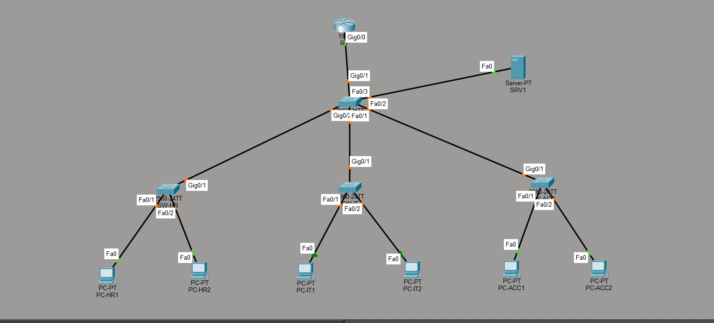

# Enterprise Office Network Design & Implementation

## Project Overview
A simulated enterprise office network designed and implemented using Cisco Packet Tracer. The network separates departments using VLANs, provides automatic IP configuration through DHCP, and implements inter-VLAN routing and ACL-based security.

## Network Topology

- 1 Cisco 1941 Router
- 4 Cisco 2960 Switches
- 6 PCs
- 1 Server

## Technologies & Concepts
- Cisco Packet Tracer
- VLAN Configuration
- Inter-VLAN Routing (Router-on-a-Stick)
- DHCP Configuration
- DNS and HTTP Server
- Access Control Lists (ACL)
- Spanning Tree Protocol (STP)
- Trunking and Access Ports
- Network Troubleshooting

## VLAN and IP Addressing

| Department | VLAN | Network |
|---|---:|---|
| HR | 10 | 192.168.10.0/24 |
| IT | 20 | 192.168.20.0/24 |
| Accounts | 30 | 192.168.30.0/24 |
| Server | 40 | 192.168.40.0/24 |

## Key Features
- Department-based network segmentation
- Automatic IP address assignment using DHCP
- Inter-VLAN communication through Router-on-a-Stick
- Internal DNS and HTTP services
- ACL-based communication restrictions between HR and Accounts
- STP monitoring and verification
- Configuration backup on all network devices

## Security Implementation
HR and Accounts departments are restricted from communicating with each other using Extended ACLs. Other permitted network communication was tested successfully.

## Testing and Verification
The following were verified:
- DHCP address assignment
- Gateway connectivity
- Inter-VLAN connectivity
- DNS name resolution
- HTTP server access
- ACL security restrictions
- Trunk status and VLAN forwarding
- MAC address learning
- STP operation

## Project Files
- `Enterprise-Office-Network.pkt` — Cisco Packet Tracer project
- `Enterprise_Office_Network_Project_Documentation.docx` — Detailed project documentation

## Disclaimer
This project was designed and tested in Cisco Packet Tracer as a network simulation, not deployed on a physical enterprise network.
